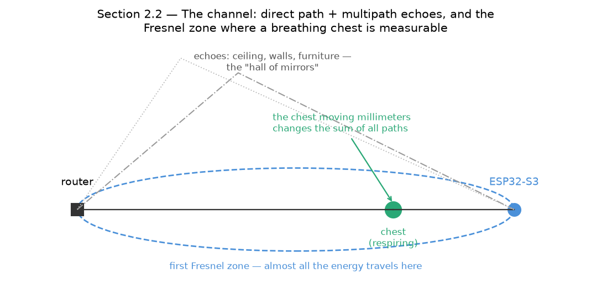
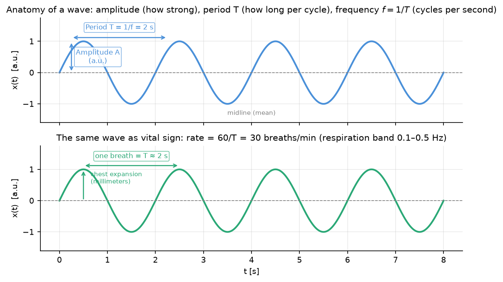
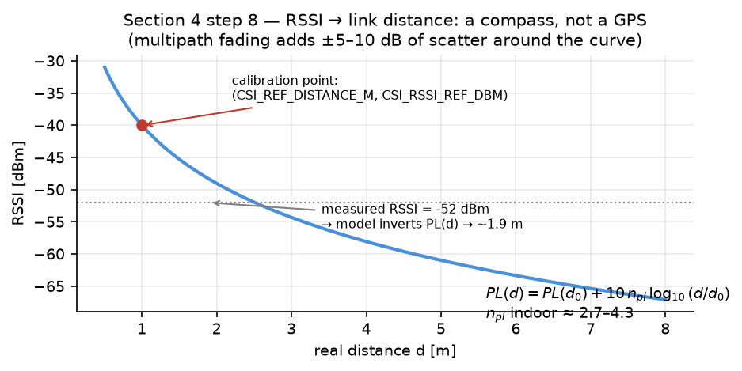
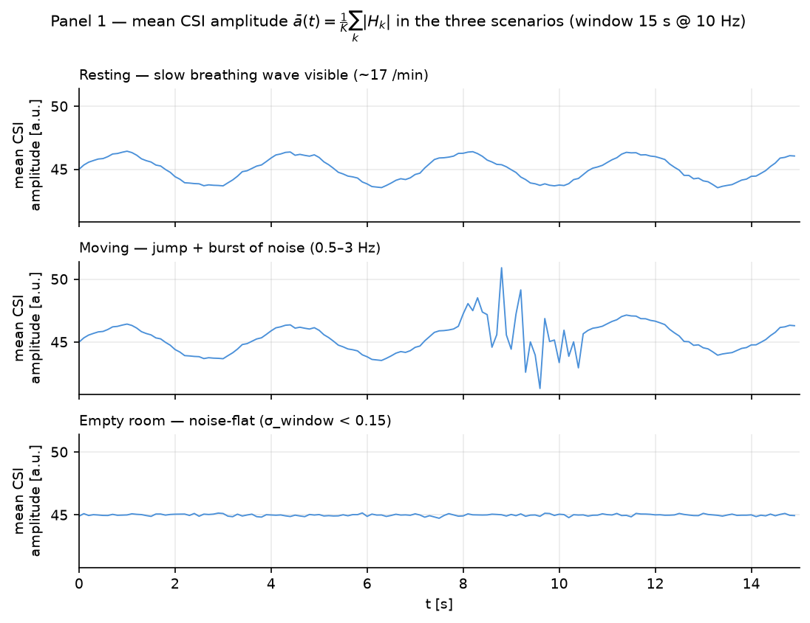
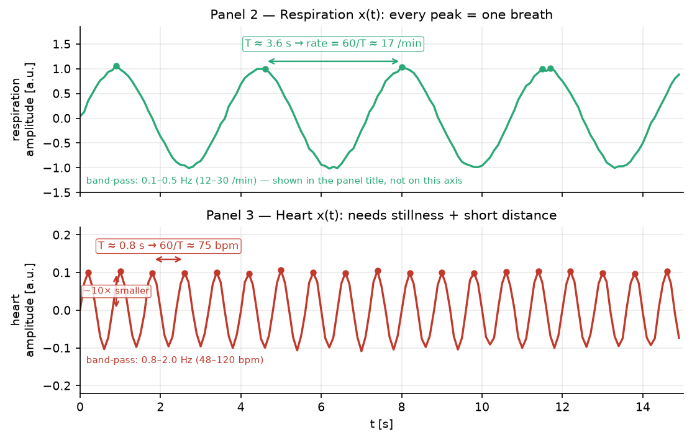
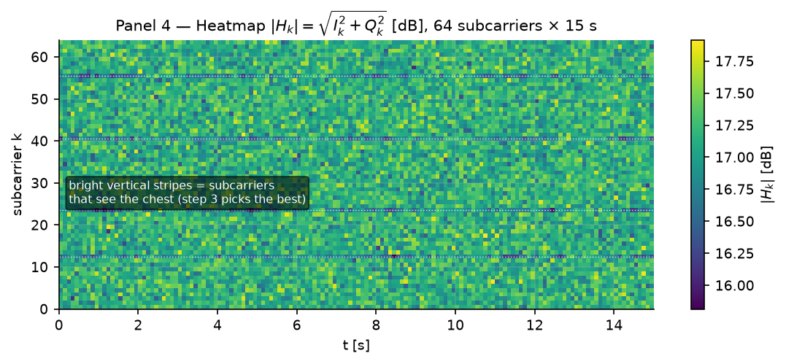
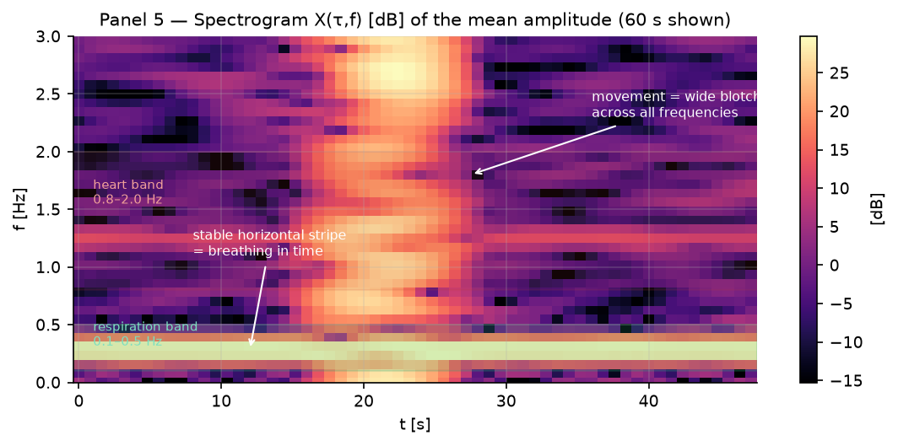
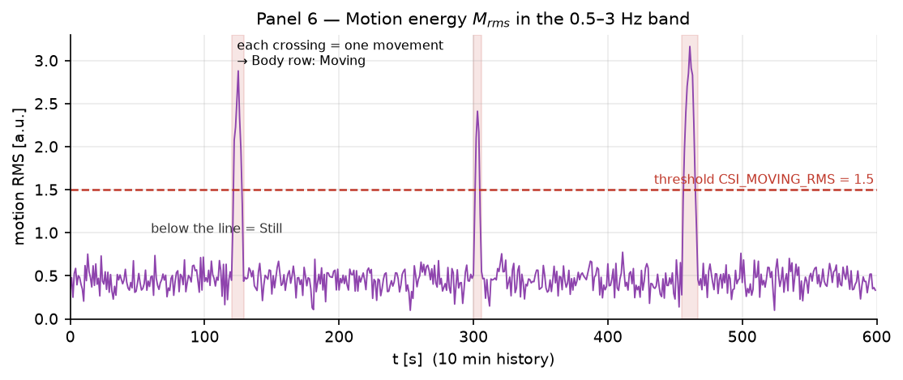

# Cómo funciona — WiFi-CSI Vital Signs (la guía "para niños, pero técnica")

> **Para quién es esta guía.** Si llegaste a este repositorio y te
> preguntás cómo un router y una placa de desarrollo pueden contar
> respiraciones sin cámara ni sensor de contacto: cada sección acá tiene
> primero la **versión en una frase** y después la **versión técnica
> exacta** (con los números reales de ESTE proyecto), para que puedas
> contar el sistema de punta a punta. La versión profunda con todas las
> fórmulas vive en `docs/SIGNAL-MODELING.md`; la documentación de cada
> software está en `docs/FIRMWARE-ESP32.md` (la placa) y
> `docs/DESKTOP-APP.md` (el aplicativo). No es un dispositivo médico: es
> una herramienta de investigación.

---

## 0. Esquema visual del sistema (pipeline end-to-end)

```mermaid
flowchart LR
    subgraph Fisico["Físico"]
        Router[("Router WiFi\n2.4 GHz OFDM")]
        Person(("Pecho\nrespira / late"))
    end
    subgraph Sensado["Sensado"]
        ESP32["ESP32-S3\nestima H_k por subportadora\nfs ≈ 10 Hz"]
    end
    subgraph Transporte["Transporte"]
        MQTT(("Mosquitto\n:1883"))
    end
    subgraph Backend["Backend Python"]
        Parse["parseo + guardias\n(NaN, n, t_us)"]
        Win["ventana deslizante\n150 × 64 (15 s @ 10 Hz)"]
        Mean["promedio ā(t)\n= (1/K)·Σ|H_k|"]
        Sel["mejor subportadora\npor banda (SNR)"]
        Filt["filtro pasa-banda\nresp 0.1–0.5 · corazón 0.8–2.0 Hz"]
        FFT["FFT + pico →\nresp/min · BPM · SNR gate"]
        Mot["RMS 0.5–3 Hz →\nAbsent / Still / Moving"]
    end
    subgraph Vista["Visualización"]
        GUI["GUI PyQt5 · 6 paneles"]
        Web["web viewer LAN\nhttp://IP:8080"]
    end
    Router -->|"señal rebota"| Person
    Person -->|"multipath modula |H_k|"| ESP32
    ESP32 -->|"MQTT CSV esp32/<id>/csi/raw"| MQTT
    MQTT --> Parse --> Win --> Mean
    Win --> Sel --> Filt --> FFT
    Mean --> Mot
    FFT --> GUI
    Mot --> GUI
    Mean --> GUI
    GUI ~~~ Web
```



**Distribución de los 6 paneles del GUI** (izquierda: trazas temporales
de la señal; derecha: vistas físicas; franja inferior: medidas):

```text
┌──────────────────────────────┬──────────────────────────────┐
│ 1 CSI medio ā(t)     [a.u.]  │ 4 Heatmap |H_k|       [dB]   │
│   x: t [s] 0–15              │   x: t [s] · y: subcarrier k │
├──────────────────────────────┼──────────────────────────────┤
│ 2 Respiración x(t)   [a.u.]  │ 5 Espectrograma X(τ,f) [dB]  │
│   banda 0.1–0.5 Hz           │   x: t [s] · y: f [Hz]       │
├──────────────────────────────┼──────────────────────────────┤
│ 3 Corazón x(t)       [a.u.]  │ 6 Motion RMS M_rms    [a.u.] │
│   banda 0.8–2.0 Hz           │   banda 0.5–3 Hz · 10 min    │
└──────────────────────────────┴──────────────────────────────┘
  Body: Still · motion RMS · σ_window · RSSI [dBm] · dist [m]
```

---

## 1. La idea en una frase

> **El WiFi de tu casa es una linterna invisible que rebota en todo — y
> cuando esa luz rebota en tu pecho, el rebote tiembla al ritmo de tu
> respiración y de tu corazón. Nosotros medimos ese temblor.**

Versión técnica: el ESP32 mide cómo llega cada subportadora de una señal
WiFi ($|H_k|$, la **CSI** — *Channel State Information*) a ~10
mediciones por segundo. El pecho, al moverse milímetros, cambia los
caminos de rebote de la señal (*multipath*) y eso modula la amplitud que
el ESP32 recibe. Esa modulación ES la respiración y el latido.

---

## 2. El sistema físico: de la onda invisible al dato

### 2.1 El espectro electromagnético y el WiFi

El WiFi de 2,4 GHz es una onda electromagnética: campos eléctrico y
magnético que **vibran 2 400 millones de veces por segundo** (eso es la
"frecuencia": cuántas vibraciones por segundo). La onda avanza a la
velocidad de la luz, así que durante **una sola vibración** recorre una
distancia fija — esa distancia es la **longitud de onda** (el trecho
entre dos crestas), y sale de dividir la velocidad por la frecuencia:

```math
\lambda = \frac{c}{f} = \frac{299{,}792{,}458\ \mathrm{m/s}}{2.412\ \mathrm{GHz}} \approx 12.44\ \mathrm{cm}
```

*(El firmware no fija el canal del router, así que 12,44 cm es una
aproximación razonable — el canal exacto haría variar unos mm.)*

**Por qué importa λ**: los objetos del tamaño de la longitud de onda
(decímetros) reflejan muy bien el WiFi. Las paredes, los muebles, los
cuerpos: todo es un espejo parcial.

### 2.2 Los ecos (multipath): la "sala de espejos"

El router emite; el ESP32 recibe. Pero NO recibe una sola copia de la
señal: recibe **la suma de miles de copias** — la que llegó directo, la
que rebotó en el techo, la que rebotó en la pared y en tu hombro, la que
atravesó tu cuerpo y se dispersó… Cada camino tiene una longitud
distinta, así que las copias llegan "desalineadas" y se suman mal o bien
según el punto donde estén. A eso se lo llama canal, y cambia **cada
vez que algo se mueve** en la sala.

**Cómo se suman**: una copia que viajó $\lambda/2 \approx 6{,}2$ cm más
que otra llega media vibración tarde — sus crestas caen sobre los
valles de la otra y se cancelan; una que viajó $\lambda \approx 12{,}4$
cm más llega una vibración entera tarde y se suma en fase de nuevo. El
canal resultante es la suma instantánea de todas las copias con sus
fases, y es sensible a cambios de posición de **milímetros**: mover un
camino 1,24 cm ($\lambda/10$) ya rota su fase 36°. El canal es,
literalmente, una huella digital de la geometría de la sala.

> **Metáfora**: es una sala llena de espejos. Si un espejo se mueve un
> milímetro, la imagen compuesta cambia. Si el "espejo" es el pecho de
> una persona respirando, la imagen tiembla 12–30 veces por minuto.



### 2.3 El pecho: el "espejo" que nos interesa

- **Respiración**: el pecho se desplaza algunos milímetros a ~1 cm,
  12–30 veces por minuto (0,1–0,5 Hz).
- **Corazón**: la piel de tu pecho se mueve **fracciones de milímetro**
  con cada latido, 48–120 veces por minuto (0,8–2,0 Hz).

Modelo del proyecto (el mismo de `docs/SIGNAL-MODELING.md` §3):

```math
x(t) \approx A_b \sin(2\pi f_b t) \quad f_b \text{ respiración} \in [0.1, 0.5]\ \mathrm{Hz}
```

Esos milímetros son **muy poco** comparados con λ (12,44 cm) — y sin
embargo alcanzan: porque el pecho está cerca de las **zonas de Fresnel**
(las "cápsulas invisibles" alrededor de la línea router–ESP32 dentro de
las que viaja casi toda la energía), un cuerpo ahí perturba la suma de
caminos de forma medible.

> **Aclaración honesta**: medir el corazón es mucho más difícil que la
> respiración, porque su desplazamiento es ~10 veces más chico. Por eso
> el sistema te muestra `-` cuando la señal no supera la compuerta de
> calidad (§5, paso 6) — prefiere decir "no sé" a inventar un número.

### 2.4 Los paquetes de red: los "flashes" de la linterna

Para medir el canal hace falta que llegue una señal. El WiFi no emite
continuo como una radio: manda **paquetes** (ráfagas cortas de
milisegundos). Y el chip está diseñado para aprovecharlas: cada frame
802.11n recibido incluye campos de **entrenamiento** — tonos que el
router emite "de referencia" — y la radio los usa para calcular cómo
llegó cada subportadora comparando lo recibido contra esa referencia.
El resultado se entrega al programa como **CSI** vía un callback del
driver (`esp_wifi_set_csi_rx_cb`): cada paquete recibido es una "foto"
del canal, sin costo extra. ¿Y si nadie está descargando nada? El
firmware **genera su propia luz**: una sesión de ping al gateway
(`USE_TRAFFIC_PING 1` en `config.h`) manda un echo ICMP cada
`CSI_INTERVAL_MS = 100` ms y el router le responde — cada respuesta
recibida dispara una foto → **fs ≈ 10 Hz**: 10 "fotos del canal" por
segundo (el mecanismo completo, en `docs/FIRMWARE-ESP32.md` §4).

### 2.5 OFDM: los 64 "colores" del flash

Un paquete WiFi moderno (802.11n, OFDM) no es un solo tono: viaja en
decenas de **subportadoras** — tonos equiespaciados dentro del canal de
20 MHz, como un acorde con ~64 notas. Para cada nota, el receptor la
compara contra **dos referencias**: la portadora misma (**I**, *in-phase*:
cuánto sobrevivió en fase) y la portadora girada 90° (**Q**,
*quadrature*: cuánto llegó desfasado). Los dos números con signo
$(I_k, Q_k)$ son las coordenadas del tono recibido visto como flecha:
su **longitud** es la amplitud y su **ángulo** es la fase. El chip
reporta esas coordenadas para **cada tono por separado** (hasta 128; el
S3 usa **~64** en la práctica, `K = csi_len/2`).

#### Qué papel cumple OFDM en cada etapa

OFDM no es algo que este proyecto implemente: es el **esquema de
modulación del estándar WiFi** (802.11n). Lo que hacemos es
*explotarlo* — su estructura es la que hace posible medir signos
vitales con una placa de ~10 USD:

| Etapa | Qué hace OFDM ahí | Qué aprovecha este proyecto |
|---|---|---|
| **Modulación / envío** (router) | Reparte los bits del paquete entre ~64 subportadoras ortogonales (cada tono con su QPSK/16-QAM/64-QAM) y antepone un **preámbulo con símbolos de entrenamiento conocidos** | Sin OFDM habría un único tono → una sola vista del canal. Las 64 subportadoras son 64 "cámaras" apuntando a la misma sala |
| **Recepción** (ESP32-S3) | El chip correlaciona el preámbulo conocido contra lo recibido y estima el canal **por subportadora**: $H_k = I_k + jQ_k$ — eso es literalmente la CSI que el driver entrega al callback | Nuestro firmware solo toma ese reporte y publica $a_k = \sqrt{I_k^2+Q_k^2}$; la estimación de canal OFDM ya la hace el hardware |
| **Procesamiento** (backend) | La ortogonalidad mantiene los tonos independientes entre sí: la señal fisiológica modula **todos** los tonos juntos (coherente) y el ruido de cada tono es **independiente** | El promedio §5-paso 1 gana √64 ≈ 8× de SNR; y §5-paso 3 puede elegir la subportadora con mejor vista del pecho por banda |
| **Robustez del enlace** | Si un tono cae en una frecuencia con interferencia, los demás siguen llevando datos (el router los baja de modulación) | Si una subportadora "ve la heladera", otra ve el pecho: de ahí el `sc#` que se muestra en pantalla |

En una frase: **OFDM convierte un canal de 20 MHz en 64 sensores
paralelos; el router lo usa para enviar datos, y nosotros leemos cómo
el pecho deformó esos 64 sensores.**

Eso es la **CSI**: por cada paquete, un vector de ~64 pares $(I_k, Q_k)$.
El firmware calcula la longitud de cada flecha —
$a_k = \lvert H_k \rvert = \sqrt{I_k^2 + Q_k^2}$ — y **descarta el
ángulo** (la fase; un diseño honesto y documentado, ver
`docs/SIGNAL-MODELING.md` §1 y el detalle físico en
`docs/FIRMWARE-ESP32.md` §5). Cada subportadora es un "punto de vista"
distinto del mismo canal: alguna mira el pecho mejor, otra está tapada
por la heladera, otra solo ve ruido.

**Comportamiento esperado** (y es lo que aprovecha el procesamiento):

- La respiración/el latido **mueven todas las subportadoras juntas y al
  mismo ritmo** (el pecho perturba caminos compartidos → señal
  *coherente*).
- El ruido de cada subportadora es **independiente** (cada tono sufre
  su propio ruido) → al promediar, el ruido se cancela y la señal queda.

### 2.6 Las propiedades de la onda, tal como las ves en pantalla

Toda gráfica del sistema es una onda en el tiempo, y toda onda se
describe con las mismas tres propiedades. Es importante leerlas bien
porque significan cosas físicas distintas acá:



| Propiedad | Qué es en la gráfica | Qué significa físicamente en este sistema |
|---|---|---|
| **Amplitud** [a.u.] | cuánto sube y baja la curva respecto a su línea media | cuánto perturba el cuerpo al canal WiFi. **No** está calibrada en mm ni en watts: es adimensional. Sirve para *presencia y calidad*, no para "cuánto te expandís" |
| **Período T** [s] | cuánto tarda un ciclo completo (pico a pico) | un ciclo = una respiración completa (o un latido). T ≈ 4 s → respiración lenta; T ≈ 0,8 s → latido |
| **Frecuencia f = 1/T** [Hz] | ciclos por segundo | lo que el sistema reporta como tasa: `60/T` da respiraciones/min o bpm. La banda 0,1–0,5 Hz = 12–30/min; la banda 0,8–2,0 Hz = 48–120 bpm |

Por eso la app dibuja **dos cosas distintas con ondas**: las trazas de
la izquierda son la onda *en el tiempo* (amplitud vs t), y el
espectrograma de la derecha es la onda *en frecuencia* (qué f están
presentes). Y por eso el número confiable del sistema es la **frecuencia**
(el ritmo), no la amplitud: la amplitud depende de la geometría del
enlace, el ritmo no.

---

## 3. La cadena de medición (los números que viajan)

```
ESP32-S3 ──MQTT (esp32/<id>/csi/raw)──► Mosquitto ──► Backend Python ──► GUI / teléfono
```

Cada medición es un CSV chiquito, ~10 veces por segundo:

```
t_us, rssi, n, seq, a0, a1, a2, ... a(n-1)
1717000000123456,-52,64,42,178,176,171,169,...
```

*(La fila nace en el firmware — `docs/FIRMWARE-ESP32.md` §5 — y la
consume el aplicativo — `docs/DESKTOP-APP.md` §3.)*

| Campo | Qué es | Unidad física |
|---|---|---|
| `t_us` | reloj del chip (desde el arranque) | microsegundos |
| `rssi` | potencia con la que llegó TODO el paquete | dBm |
| `n` | cuántas subportadoras trae | — |
| `seq` | número de secuencia del paquete | — |
| `a0..a(n-1)` | amplitud de cada subportadora: $a_k = \sqrt{I^2+Q^2}$ | adimensional ("a.u.") |

**Unidades, de una vez** (las mismas que ahora ves en los ejes del GUI):
las amplitudes CSI son **adimensionales** (un número que el chip
entrega, sin watts ni voltios); el heatmap y el espectrograma las
convierten a **dB** para que quepa todo en pantalla; RSSI va en
**dBm**; las frecuencias en **Hz**; el tiempo en **s**.

### 3.1 Cómo se mide cada magnitud física — y cómo se sostiene la precisión

**RSSI** (Received Signal Strength Indicator): es la **potencia total
con la que llegó el paquete completo**, medida por el front-end de
radio del ESP32 (las lecturas de ganancia/energía del receptor) y
reportada por el chip **por paquete, en dBm**. No es por subportadora
(eso es $|H_k|$): es el "volumen total" del paquete. El backend lo
**promedia sobre la ventana** para estabilizarlo y, si está calibrado,
invierte el modelo log-distance para estimar la distancia del enlace:



`PL(d) = PL(d₀) + 10·n_pl·log₁₀(d/d₀)` con constantes
`CSI_RSSI_REF_DBM`, `CSI_REF_DISTANCE_M`, `CSI_PATH_LOSS_N`. Sin
calibración, la estimación se apaga (`—`) en vez de inventar metros.
**Límite honesto**: el *fading* por multipath mete ±5–10 dB de
 dispersión alrededor de esa curva → la distancia es una **brújula, no
un GPS** (§4 paso 8, `SIGNAL-MODELING.md` §6).

**Cómo se sostiene la precisión** (qué protege cada mecanismo, todos
verificables en `config.py` / `link_manager.py` / `vitals_processor.py`):

| Mecanismo | Qué precisión protege |
|---|---|
| Ping cada 100 ms (`CSI_INTERVAL_MS`) | muestreo **constante a fs ≈ 10 Hz**: sin ritmo fijo, la FFT no tiene escala de tiempo confiable |
| Guardias de `t_us` (NaN/inf, retrocesos) | que un timestamp corrupto no estire ni comprima la ventana |
| Guardia de ancho `n` fijo | que una fila con otra cantidad de subportadoras no desalinee la matriz 150×K |
| Cola + contador `dropped` | backpressure visible sin bloquear la red: si se pierde, se sabe |
| `detrend` + ventana de Hann | que los bordes de la ventana no "sangren" energía falsa al espectro |
| `sosfiltfilt` (adelante y atrás) | filtrado **sin desfase**: los picos quedan alineados con la señal real |
| Compuerta SNR ≥ 6 dB (`CSI_MIN_SNR_DB`) | honestidad: sin pico que sobresalga del piso, se muestra `-` |
| Interpolación parabólica del pico | resolución sub-bin: la tasa no queda atrapada en la rejilla de la FFT |
| Fusión multi-link por mejor SNR + expiración 20 s | que una placa tapada no gane por inercia; gana la mejor vista viva |
| Estimación a 1 Hz + mediana de 5–10 lecturas | estabilidad de lectura (protocolo §1 del VALIDATION-PROTOCOL) |

---

## 4. El viaje de una medición: de la onda al número en pantalla

La historia completa de UNA medición, sin saltos — cada paso con su
profundización:

1. **El router emite un frame** 802.11n: una ráfaga de ~64 tonos
   equiespaciados (OFDM) que viaja a la velocidad de la luz.
2. **La onda recorre la sala y rebota**: paredes, techo, muebles… y el
   pecho de una persona, que se mueve milímetros al respirar. Cada copia
   llega a la placa con su propio retraso y su propia atenuación (§2.2).
3. **La radio de la ESP32 recibe la suma de todas las copias.** Por cada
   tono, el driver demodula contra las dos referencias (§2.5) y entrega
   $(I_k, Q_k)$ — las coordenadas de cómo llegó ese tono.
4. **El firmware reduce cada flecha a su longitud**:
   $a_k = \sqrt{I_k^2 + Q_k^2}$ (0–255), pega el reloj (`t_us`), la
   potencia del paquete (`rssi`) y el número de orden (`seq`), y suelta
   la fila a una cola.
5. **Cada 100 ms, la fila viaja como CSV por MQTT** al tópico de SU
   placa (`esp32/<id>/csi/raw`) — el ping propio garantiza el ritmo
   (§2.4). El firmware completo: `docs/FIRMWARE-ESP32.md`.
6. **El aplicativo recibe la fila, la valida y la apila**: guardas de
   integridad (¿NaN? ¿reloj que retrocede? ¿ancho que cambió?) y una
   ventana deslizante de 15 s — 150 filas × ~64 tonos, por placa.
7. **El DSP busca la señal**: para cada banda fisiológica elige el tono
   que "mejor ve" el pecho (mejor SNR), le quita la deriva, la filtra a
   la banda y la mira con la FFT (§5, pasos 3–5).
8. **La compuerta de honestidad decide**: si el pico no sobresale 6 dB
   del piso de ruido, no hay número — la pantalla muestra `-`
   (§5, paso 6).
9. **La GUI pinta**: trazas crudas y filtradas, el heatmap de las 64
   subportadoras, el espectrograma, y los BPM / respiraciones por
   minuto. Con varias placas, cada banda gana la que mejor la ve. El
   aplicativo completo: `docs/DESKTOP-APP.md`.

Una persona sentada entre el router y la placa desplaza el pecho unos
milímetros por respiración: eso rota las fases de los caminos que la
rozan, cambia la suma que recibe la antena, y la medición tiembla con
ese ritmo — el resto del viaje consiste en **no perder ese temblor por
el camino**.

---

## 5. El "lavado" de datos: de 64 números ruidosos a 1 número legible

Esta es la guía práctica de cada paso. `ENTRA → SE HACE → SALE → POR QUÉ`.

**Paso 0 — Los guardias de la puerta.**
ENTRA un paquete → se descarta si tiene NaN/inf, timestamps que
retroceden o cambio de ancho (n) a mitad de ventana → SALE solo lo
íntegro. *POR QUÉ: una sola fila corrupta envenena la FFT.*

**Paso 1 — Promediar las ~64 subportadoras: $\bar{a}(t) = \frac{1}{K}\sum|H_k|$.**
ENTRA la fila de 64 amplitudes → SALE el promedio (1 número por
instante). *POR QUÉ: el pecho mueve todos los tonos juntos (coherente)
pero el ruido de cada tono es independiente → el promedio conserva la
respiración y degrada el ruido $\sqrt{64} = 8$ veces.* Esa $\bar{a}(t)$ es la **gráfica
cruda** del panel superior izquierdo.

**Paso 2 — La ventana de 15 s.**
ENTRA el chorro continuo → SALE una ventana deslizante de
`N = 10 Hz × 15 s = 150` filas. *POR QUÉ: para que la FFT tenga con qué
trabajar hacen falta varios ciclos: 15 s contienen ~4 respiraciones y
~15 latidos.*

**Paso 3 — Elegir la MEJOR subportadora por banda.**
ENTRA la ventana completa (150 × 64) → por cada subportadora se le quita
la tendencia (`detrend`), se le aplica Hann (alisa los bordes para que
la FFT no "sangrar"), se calcula su espectro y su pico dentro de la
banda; se elige la de mejor SNR → SALE 1 subportadora por banda.
*POR QUÉ: alguna subportadora "ve" el pecho con claridad y otra solo ve
la heladera; usamos la mejor vista y reportamos cuál fue (sc# en
pantalla).*

**Paso 4 — Filtro por banda (el "colador").**
ENTRA la mejor serie → SALE la misma serie filtrada con un
pasa-banda Butterworth: **respiración 0,1–0,5 Hz** (6–30/min) y
**corazón 0,8–2,0 Hz** (48–120 bpm), filtradas hacia adelante Y hacia
atrás (`sosfiltfilt`) para no desfasar nada. *POR QUÉ: el cuerpo solo
puede respirar/latir en esos rangos — todo lo demás es ruido y se
descarta por construcción.*

**Paso 5 — La FFT: contar las oscilaciones.**
ENTRA la ventana filtrada → SALE el pico espectral (con interpolación
parabólica para no quedarse en la frecuencia de la rejilla) →
f_respiración y f_corazón en Hz. *POR QUÉ: la FFT separa "cuántas veces
por segundo tiembla" — que es, literalmente, la definición de frecuencia.
18/min de respiración = 0,3 Hz.*

**Paso 6 — La compuerta de honestidad (SNR ≥ 6 dB).**
ENTRA el pico de la banda y el piso espectral de esa subportadora →
`SNR = pico / mediana del piso` → si SNR < 6 dB (`CSI_MIN_SNR_DB`), el
sistema muestra **`-`**. *POR QUÉ: si el pico no sobresale del ruido, el
número sería una invención. Sin señal suficiente: no hay número. Eso es
diseño, no un bug.*

**Paso 7 — Presencia y movimiento (la fila "Body").**
ENTRA la ventana cruda → SALE: **σ de la ventana** (sala vacía = señal
plana, σ < 0,15 → `Absent`); **RMS de la banda 0,5–3 Hz** (> 1,5 →
`Moving`; si no, `Still`). *POR QUÉ: el cuerpo quieto es ruido lento
plano; moverse agita toda la banda de movimiento.*

**Paso 8 — RSSI → distancia de enlace.**
ENTRA el RSSI promedio (dBm) → SALE una distancia estimada (m) vía
modelo log-distance `PL(d)` calibrable (`CSI_RSSI_REF_DBM`,
`CSI_REF_DISTANCE_M`, `CSI_PATH_LOSS_N`; indoor `n_pl ≈ 2,7–4,3`). Sin
calibrar se apaga con `CSI_RSSI_REF_DBM=none` → el GUI muestra `—`.
*POR QUÉ: la señal se atenúa con la distancia; con dos puntos de
referencia medidos, se puede interpolar. Es una brújula, no un GPS.*

**Paso 9 — Multi-ESP32 (varias placas = varios puntos de vista).**
Cada placa publica en su propio tópico (`esp32/<id>/csi/raw`); el
backend mantiene un pipeline aislado por placa y fusiona: para
respiración y para corazón gana **la placa con mejor SNR de esa banda**
(pueden ser distintas); presencia = conservadora (cualquier placa que
ve movimiento → `Moving`). Un link silencioso **expira a los 20 s**
(`LINK_STALE_S`), el registro guarda 16 links con desalojo LRU.
*POR QUÉ: dos vistas del mismo pecho; la que "ve mejor" gana cada
medición, y una placa apagada no gana nada para siempre.*

---

## 6. Las gráficas: qué mide cada una y cómo leerla

El GUI de escritorio tiene 6 paneles + una franja de medidas bajo el
canvas que lista todas las cantidades con sus unidades. Ejecutá el
simulador (`python ..\scripts\simulate_esp32.py --scenario resting`) y
vas a ver cada escenario sin hardware.

### Izquierda — las 3 trazas temporales (eje x: `t [s]`, 0–15 s)

**1. CSI medio $\bar{a}(t)$ — "materia prima" [a.u.]**
La amplitud promedio cruda. *Cómo leerla*: a simple vista ya se ve la
respiración como una onda lenta y suave; un movimiento corporal es un
salto brusco; la sala vacía es casi una línea con ruido fino. Si esta
gráfica está muerta-planilla, nada de lo que sigue va a funcionar —
mirá el pkt/s en la barra de estado.



**2. Respiración `x(t)` — banda 0,1–0,5 Hz [a.u.]**
La misma señal, ya filtrada a la banda respiratoria. *Cómo leerla*:
contá los picos — cada pico es una respiración (una cada 2–10 s es
normal: 12–30/min). El título dice qué subportadora ganó (`sc#`) y con
qué calidad (`SNR` en dB). Onda pareja = persona quieta respirando.

**3. Corazón `x(t)` — banda 0,8–2,0 Hz [a.u.]**
La señal cardíaca filtrada. *Cómo leerla*: la amplitud es muchísimo más
chica (el latido mueve ~10 veces menos que la respiración) — por eso
necesita quietud y distancia corta (0,5–2 m). Picos regulares =
latidos; el número grande arriba es el BPM. Si hay movimiento, esta
traza se ensucia primero.



### Derecha — los 3 paneles físicos (1 Hz)

**4. Heatmap de subportadoras $|H_k|$ [dB]**
Todas las subportadoras a la vez (y = subportadora, x = tiempo, color =
amplitud). *Cómo leerla*: las franjas verticales más claras son las
subportadoras "buenas" — las que el paso 3 elige. Si todo el panel se
oscurece de golpe, algo tapó el enlace.



**5. Espectrograma `X(τ,f)` [dB]**
El contenido de frecuencia de $\bar{a}(t)$ a lo largo del tiempo. *Cómo
leerla*: buscá una **franja horizontal** — una línea brillante y
estable a la altura de la frecuencia respiratoria (~0,2–0,3 Hz) es tu
respiración dibujada en el tiempo; la franja resaltada en verde/rojo
son las bandas fisiológicas que el sistema usa. Un movimiento = mancha
ancha que sube y baja.



**6. Energía de movimiento `M_rms` [a.u.]**
La banda 0,5–3 Hz en el tiempo (10 min de historia), con la línea roja
del umbral (`CSI_MOVING_RMS`, 1.5). *Cómo leerla*: por debajo de la
línea = quieto; cada pico que la cruza = un movimiento; el Body row
cambia a `Moving` exactamente cuando la traza cruza esa línea.



### La fila "Body" y la barra de meta
`Body: Still | motion 0.42 RMS | σ_window 0.31 | RSSI -52 dBm | link dist ~1.0 m`
— presencia (estado), la energía de movimiento, el "planismo" de la
señal, la potencia del enlace y la distancia estimada. La barra de
meta agrega las subportadoras ganadoras, el SNR de cada banda y el
tamaño de la ventana; con varias placas, la barra de estado lista los
links y cuál es el primary (el que gana el corazón).

---

## 7. Resultados esperados y límites (honestos)

- **Respiración**: robusta a 0,5–4 m con línea de vista; funciona hasta
  con alguien en la misma sala sin línea directa.
- **Corazón**: el más frágil — necesita quietud, 0,5–2 m, línea de
  vista; con personas moviéndose cerca, mostrá esperanza de ver `-`.
- **Varias personas**: el sistema mide "el ambiente" — dos personas
  respirando desincronizadas se mezclan. Es una limitación conocida del
  enfoque de amplitud (sin fase es difícil separar).
- **Sin fase**: la fase (`atan2(Q,I)`) haría la medición ~10× más
  sensible; el firmware actual la descarta (futuro camino documentado
  en `SIGNAL-MODELING.md` §3).
- **No es un dispositivo médico.** Nunca lo fue. Es un experimento de
  física ingenieril sobre tu propia sala.

---

## 8. Tres frases listas para alguien no técnico

1. *"El WiFi rebota en todo, igual que un grito en un cañón. Cuando rebota
   en tu pecho, tiembla al ritmo de tu respiración y tu corazón — y esta
   cajita con antena lee ese temblor."*
2. *"La señal WiFi viaja en 64 tonitos a la vez, como un acorde. Tu
   respiración desafina el acorde entero poquito pero todos juntos, y el
   ruido desafina cada tono por su lado — entonces promediamos los 64 y
   el ruido se cancela y tu respiración queda."*
3. *"Cada paquete de datos es una foto del eco de la señal. La cajita
   manda 10 fotos por segundo, el programa las apila 15 segundos, cuenta
   cuántas veces por minuto tiembla la foto — y ese número es tu
   respiración."*

---

## 9. Para profundizar

| Querés saber… | Andá a |
|---|---|
| El software que corre en la placa (arranque, tareas, ping, provisioning) | `docs/FIRMWARE-ESP32.md` |
| El aplicativo de escritorio por dentro (hilos, flujo, ciclo de vida) | `docs/DESKTOP-APP.md` |
| Las fórmulas exactas implementadas (paso a paso del §5 de acá) | `docs/SIGNAL-MODELING.md` §4 |
| Calibrar presencia/movimiento y RSSI | `docs/SIGNAL-MODELING.md` §6 |
| El protocolo de validación empírica | `docs/VALIDATION-PROTOCOL.md` |
| Cómo desplegarlo paso a paso | `DEPLOYMENT.md` |
| La arquitectura del pipeline y el stack | `docs/PROJECT-ARCHITECTURE.md` |
| El inventario de funciones del GUI | `docs/SIGNAL-MODELING.md` §9 |
