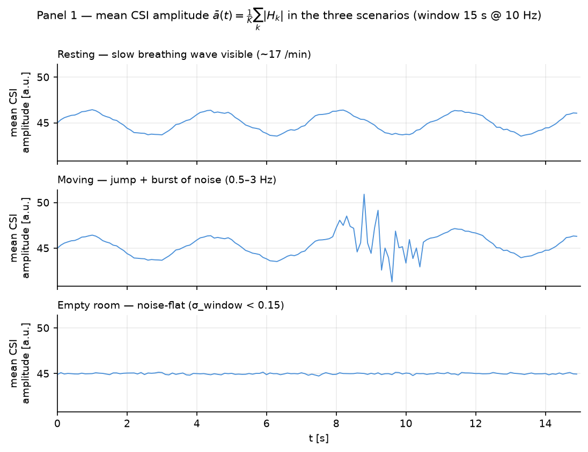
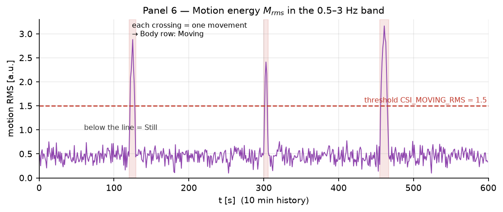

# Protocolo de validación — demostrar que el sensor lee un cuerpo, no ruido

> Términos acuñados en la literatura se citan en inglés sin traducir (CSI,
> RSSI, SNR); la prosa es en español.

Por qué existe este documento: las estimaciones mostradas fluctúan, las
salas son ruidosas, y una pregunta justa es *"¿cómo hago las lecturas más
estables, y cómo justifico empíricamente que vienen de una persona y no del
ruido ambiente?"*. Este protocolo es la respuesta empírica: una secuencia de
tests falsables. Si el sistema los pasa, la señal es tuya.

Documentos compañeros: `SIGNAL-MODELING.md` (la física y la cadena de
procesamiento), `DEPLOYMENT.md` §10 (procedimiento de test en vivo).

## 1. Setup para estabilidad (hacer antes de cada medición)

1. **Geometría primero.** El enlace de radio medido es **placa ↔ router** —
   el sujeto perturba ESA línea, no la placa sola. Sentate a 0,5–2 m de la
   placa con la línea recta placa→router pasando cerca de tu torso (primera
   zona de Fresnel, `SIGNAL-MODELING.md` §3), con línea de vista, sin paredes
   ni objetos metálicos grandes en el medio.
2. **Ambiente.** Ninguna otra persona o mascota moviéndose en la sala, sin
   ventiladores/dispositivos oscilantes, con distancia de microondas y otras
   fuentes de 2.4 GHz.
3. **Tiempo y promediado.** Sentate quieto al menos 60 s. Tratá cada lectura
   como la **mediana de las últimas 5–10 estimaciones mostradas** — las
   lecturas de un segundo son muestras, no la medición.
4. **Compuerta de honestidad.** Subí la compuerta SNR para rechazar ventanas
   marginales: `set CSI_MIN_SNR_DB=9` antes de lanzar el GUI/viewer
   (default 6). Un `-` en pantalla es información; un número fluctuante de
   una ventana por debajo de la compuerta es ruido disfrazado de dato.
5. **Piso de referencia.** Si el SNR mostrado en la línea de meta se mantiene
   debajo de ~9–10 dB, reposicioná (mové la placa, cambiá la geometría del
   enlace) en vez de confiar en una ventana marginal.

## 2. Test de falsificación — la sala vacía (el ruido no puede fingir signos vitales)

Dejá la sala **completamente vacía** durante 5 minutos con todo corriendo
(placa encendida, broker, GUI).

- Esperado: `Body: Absent`, ambas tasas mostrando `-` (la ventana se llena
  pero el SNR en banda queda debajo de la compuerta — el canal de una sala
  vacía es ruido plano).
- Registrá el resultado. Si aparecen signos vitales en una sala vacía, el
  ambiente está produciendo un tono falso (un ventilador, un dispositivo
  oscilante): encontralo o mové el enlace. Este test es el control negativo
  de todos los demás.

## 3. Test de respiración controlada — la prueba empírica más fuerte

Vos controlás la entrada; si el sensor la sigue, la señal es tuya.

1. Poné una app de metrónomo en 6 respiraciones/min (5 s inhalar, 5 s
   exhalar) y respirá siguiéndola durante 2 minutos.
2. Lectura esperada: **~6 /min** dentro de la tolerancia documentada ±3.
3. Cambiá el metrónomo a 12 respiraciones/min y respirá otros 2 minutos.
4. Esperado: la respiración mostrada **sigue el cambio** hasta ~12/min.

Es un phase-lock entre una entrada fisiológica conocida y la medición — el
ruido no tiene razón para seguir tu metrónomo. La tolerancia ±3/min es la
misma spec que imponen los tests unitarios sintéticos (los tests codifican
60 bpm / 15 resp/min ± sus compuertas).

## 4. Test de respuesta al movimiento

Caminá unos segundos → la fila `Body` debe pasar a `Moving` y los signos
vitales se resetean (la ventana se recontamina con movimiento grueso);
sentate quieto → `Still` y estabilización en ~15–20 s. Una máquina de estados
que responde a TU cuerpo — y se resetea con TU movimiento — es
sensor-driven por construcción.

## 5. Comparación con referencia — precisión cuantitativa

Corré una referencia simultánea durante un período quieto de 5 minutos:

- Pulsioxímetro de teléfono / smartwatch / correa pectoral (cualquiera).
- Anotá pares (referencia, sistema) una vez por minuto durante 5 minutos.
- Esperado: corazón dentro de **±5 bpm** y respiración dentro de **±3/min**
  (las tolerancias que codifica la suite de tests).

## 6. Repetibilidad

Repetí la §3 (o la §5) **tres veces** en el mismo setup. Resultados
consistentes dentro de tolerancia = la medición es reproducible; resultados
a la deriva = la geometría del enlace es inestable (volver a §1).

## 7. Leer la fluctuación con honestidad

- La fisiología real fluctúa: ±2–3 bpm de variación latido-a-latido es
  normal.
- El ruido ambiente AGREGA varianza; no crea tonos sostenidos en banda que
  sigan tu respiración (§3) ni desaparezcan cuando salís (§2).
- Las herramientas para la estabilidad son geometría, compuerta SNR y
  promediado por mediana — en ese orden de impacto.

## 8. Qué registrar (el log de experimentos)

Para cada sesión anotá: fecha/hora, sala, posición de la placa (relativa al
router y al sujeto), distancia del sujeto, `CSI_MIN_SNR_DB`, el resultado de
los 5 min de sala vacía, lecturas del metrónomo (ambos ritmos), pares de
referencia si los hubo. Con ese log, cualquier trabajo futuro de precisión
(segundo nodo, fusión ponderada) tiene una línea de base que superar.

## 9. El camino honesto hacia claims de grado médico

> **Leer esto primero.** Este proyecto **no es un dispositivo médico** — ni
> ahora, ni cambiando un flag de configuración. Esta sección documenta qué
> separa al prototipo de investigación de hoy de un claim de grado médico,
> para que nadie confunda ambición con certificación.

**Qué lo bloquea hoy** (cada ítem es una brecha dura, no un comentario TODO):

1. **CSI solo de amplitud.** El firmware descarta la fase
   (`SIGNAL-MODELING.md` §1); la amplitud sola es ~10× menos sensible y no
   puede desambiguar de forma confiable a dos personas o un ventilador.
2. **Hardware de propósito general.** Una radio ESP32 nunca fue diseñada ni
   caracterizada como front-end fisiológico (sin cadena RF certificada, sin
   specs médicas de clock/AQC).
3. **Sin estudio de verdad de referencia.** Las tolerancias de §5
   (±5 bpm / ±3 /min) son compuertas de ingeniería contra wearables de
   consumo — no concordancia medida contra ECG/capnografía sobre una
   población de estudio.
4. **Sin calibración por ambiente.** Cada sala tiene multipath distinto; no
   existe caracterización por instalación.

**La escalera** (cada peldaño presupone el anterior):

| Peldaño | Trabajo requerido | Estándar de referencia / evidencia |
|---|---|---|
| 1. Mejoras de sensado | Usar fase + IQ (saneamiento de fase por multiplicación conjugada), fusión multi-antena o multi-placa, endurecimiento de la selección por subportadora | `SIGNAL-MODELING.md` §3 (camino futuro documentado) |
| 2. Verdad de referencia | Registro simultáneo a ciegas vs **ECG** (corazón) y **capnografía / banda respiratoria** (respiración); N ≥ 20–30 sujetos de distintas edades/IMC; protocolo de geometría fija | Protocolo de estudio pre-registrado; aprobación de ética/IRB |
| 3. Evidencia estadística | Límites de concordancia Bland–Altman, MAE/RMSE por banda, sensibilidad/especificidad de presencia, catálogo de modos de falla por ambiente | Publicación con peer-review o reporte interno validado |
| 4. Sistema de calidad | Controles de diseño, suite de verificación y validación, análisis de riesgo documentado para el uso previsto | **ISO 13485** (QMS), **ISO 14971** (riesgo), **IEC 62304** (ciclo de vida de software) |
| 5. Regulatorio | Clasificación como SaMD; en Colombia: registro sanitario **INVIMA**; EE.UU.: FDA 510(k) (los signos vitales sin contacto son típicamente Clase II); UE: conformidad MDR | Marco IMDRF SaMD; revisión de organismo notificado / agencia |

**Lo que este repositorio puede claim-ear honestamente hoy:** los tests de
falsificación de §2–§6 (sala vacía, respiración controlada, comparación con
referencia), una compuerta de honestidad SNR que muestra `-` en vez de
adivinar, y tolerancias de ingeniería contra wearables de consumo. **Lo que
no puede claim-ear:** precisión diagnóstica, validez clínica o aptitud para
cualquier decisión de salud.

**Si el objetivo es un instrumento de investigación validado** (no un
dispositivo): los peldaños 1–3 alcanzan — publicar el protocolo, los datasets
y el análisis de concordancia, manteniendo el rotulado de solo-investigación.
Los peldaños 4–5 son un esfuerzo organizacional de años, no un cambio de
código.
